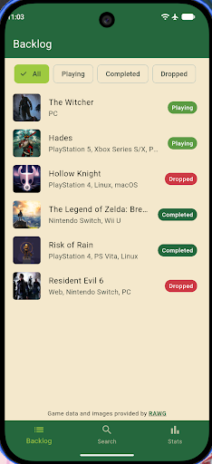
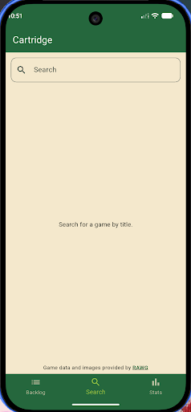
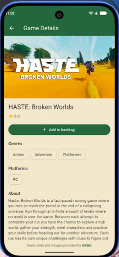
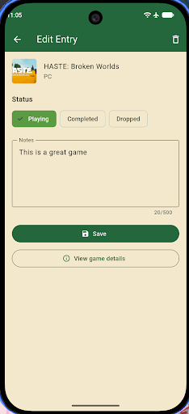
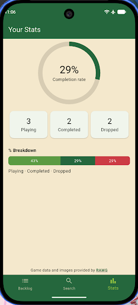
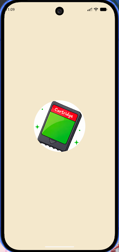
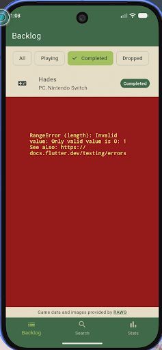

# Cartridge

A game backlog tracker for Android, built with Flutter and Dart. Search for games, add them to a personal backlog, mark each one as **Playing**, **Completed**, or **Dropped**, and see your completion rate.

Final Project for **SE2142 – Software Engineering Tools and Practices** (Section BSSE-2), Group **XaNikk**.

## Screenshots

| Backlog | Search | Game Details |
|---|---|---|
|  |  |  |

| Edit Entry | Stats | Splash |
|---|---|---|
|  |  |  |

## Features

- **Game search** – search the RAWG database by title, with loading, error (Retry), and empty states.
- **Game details** – cover, rating, Metacritic score, genres, platforms, and description.
- **Add to backlog** – saves a game with the status Playing (Create).
- **Backlog list with status filter** – All, Playing, Completed, Dropped (Read).
- **Edit entry** – change the status and write notes (Update).
- **Remove entry** – deletes a game after a confirmation dialog (Delete).
- **Stats** – completion rate ring, counts per status, and a percentage breakdown bar.
- **Works offline** – the backlog is saved on the device, so Backlog and Stats need no internet.
- **Error and edge-case handling** – no internet, API errors, timeouts, damaged saved data, stale search results, and double taps.
- **Custom theme, app icon, splash screen, and app name.**

## Packages Used

| Package | Purpose |
|---|---|
| [http](https://pub.dev/packages/http) | Calls the RAWG REST API |
| [provider](https://pub.dev/packages/provider) | State management with `ChangeNotifier` |
| [shared_preferences](https://pub.dev/packages/shared_preferences) | Saves the backlog on the device |
| [url_launcher](https://pub.dev/packages/url_launcher) | Opens the RAWG attribution link |
| [cupertino_icons](https://pub.dev/packages/cupertino_icons) | Icons |
| [flutter_launcher_icons](https://pub.dev/packages/flutter_launcher_icons) | Generates the app icon (dev) |
| [flutter_native_splash](https://pub.dev/packages/flutter_native_splash) | Generates the splash screen (dev) |
| [flutter_lints](https://pub.dev/packages/flutter_lints) | Lint rules for `flutter analyze` (dev) |

Game data and images are provided by the [RAWG Video Games Database API](https://rawg.io/apidocs).

## Setup and Run

### Requirements
- Flutter SDK (Dart 3.12 or newer)
- Android Studio with an Android emulator, or an Android phone with USB debugging on
- A free RAWG API key from https://rawg.io/apidocs

### Steps
1. Clone the repository:
   ```bash
   git clone https://github.com/Vaintseishii/SeTools_FinalProject_XaNikk.git
   cd SeTools_FinalProject_XaNikk
   ```
2. Install the packages:
   ```bash
   flutter pub get
   ```
3. Start an emulator or connect a phone, then check it is detected:
   ```bash
   flutter devices
   ```
4. Run the app with your key:
   ```bash
   flutter run --dart-define=RAWG_KEY=your_key_here
   ```

### About the API key
The key is **not** stored in the code or in the repository. It is passed at build time with `--dart-define` and read with `String.fromEnvironment('RAWG_KEY')`. If the key is missing, the app shows a clear message instead of sending a broken request.

### Build a release APK
```bash
flutter clean
flutter pub get
flutter build apk --release --dart-define=RAWG_KEY=your_key_here
```
The file is created at `build/app/outputs/flutter-apk/app-release.apk`.

The `INTERNET` permission is declared in `android/app/src/main/AndroidManifest.xml`. Flutter adds it automatically only for debug builds, so without it the release APK cannot reach RAWG.

### Run the checks
```bash
dart format lib test
flutter analyze
flutter test
```

## Project Structure

```
lib/
├── main.dart                 App entry, ChangeNotifierProvider, named routes
├── app_routes.dart           Route name constants
├── app_theme.dart            Color palette and ThemeData
├── models/
│   ├── game.dart             Game + Game.fromJson (RAWG data)
│   └── backlog_entry.dart    BacklogEntry, BacklogStatus, toJson/fromJson
├── services/
│   └── rawg_service.dart     RawgService (http), RawgException
├── providers/
│   └── backlog_provider.dart BacklogProvider (ChangeNotifier) + local saving
├── screens/                  Main, Backlog, Search, Game Details, Edit Entry, Stats
└── widgets/                  GameTile, StatusChip, RawgAttribution
test/                         Provider tests, Backlog screen test, app start test
```

## Team Members and Roles

| Member | GitHub | Role |
|---|---|---|
| Xanth Reign Palmes | [@Vaintseishii](https://github.com/Vaintseishii) | UI lead, navigation, Git/repository manager, documentation. Built the Backlog, Game Details, and Edit Entry screens, the shared widgets, the theme, and the error and edge-case handling. |
| Nikko Teopengco Delos Santos | [@Nikko-tds](https://github.com/Nikko-tds) | API and data layer, state management, QA/testing, release build. Built the Game model, `RawgService`, `BacklogProvider`, the Search and Stats screens, the tests, and the release preparation. |

## Git Workflow

- Every task is a GitHub issue assigned to one member.
- Each issue is developed on its own branch (for example `feature/8-backlog-provider-local-saving`, `fix/errors-edge-cases`).
- `main` only receives code through pull requests, and each pull request is reviewed by the member who did not write it.
- Commit messages follow the Conventional Commits format, for example `feat(backlog): show backlog list with status filter chips`.

## Debugging Cases

### Case 1: RangeError in the filtered Backlog list

**Symptom.** After tapping the **Completed** filter, a red error box appeared under the list with `RangeError (length): Invalid value: Only valid value is 0: 1`. The **Dropped** filter, which had no games, showed `Valid value range is empty: 0`.



**How it was found.** `flutter analyze` reported no issues because the code was valid Dart. The stack trace in the VS Code debug console pointed to the first line in our own code, `backlog_screen.dart:30`, inside the `ListView.builder`:

```
RangeError (length): Invalid value: Only valid value is 0: 1
#0  List.[] (dart:core-patch/growable_array.dart)
#1  BacklogScreen.build.<anonymous closure> (backlog_screen.dart:30:44)
```

**Cause.** `itemCount` used the full list (`backlog.entries.length`), but `itemBuilder` read from the filtered list (`backlog.filteredEntries`). With the All filter both lists matched, so the bug only appeared when a filter made the filtered list shorter.

**Fix.** `itemCount` now uses the same filtered list the builder reads from, and an empty filter shows a "No ... games." message. The fix was applied with hot reload.

```dart
// Before (bug)
itemCount: backlog.entries.length,
final entry = entries[index];   // entries = filteredEntries

// After (fix)
itemCount: entries.length,
final entry = entries[index];
```

**Prevention.** A regression widget test, `test/backlog_screen_test.dart`, switches the filter to Completed and then Dropped and checks that the right rows or message appear without errors.

### Case 2: Slow frames on the emulator (Flutter DevTools)

**Symptom.** Scrolling the Search results ran at about 14 to 16 FPS on the Android emulator.

**How it was found.** The DevTools **Performance** tab (Flutter frames chart) showed short UI-thread bars and tall raster-thread bars, so the Dart and Provider code was not the bottleneck.

**What was tried.** Decoding cover images at a smaller size (`cacheWidth` in `GameTile`) and changing the emulator graphics setting did not change the result.

**Result.** On a Samsung Galaxy S25 FE, the same build held **60 FPS** with no slow frames, so the slowdown came from the emulator's rendering and not from the app.

## Links

- Repository: https://github.com/Vaintseishii/SeTools_FinalProject_XaNikk
- RAWG API: https://rawg.io/apidocs